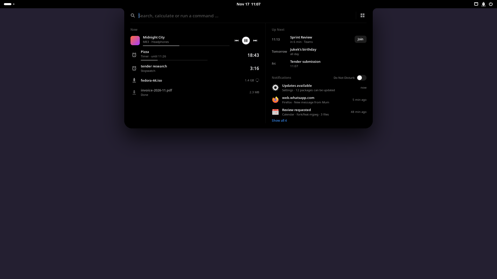
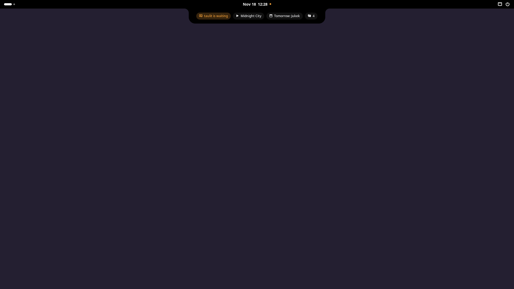
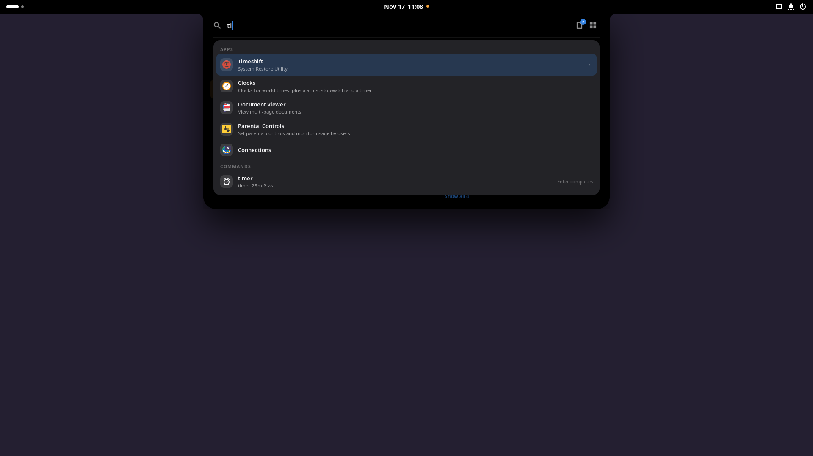
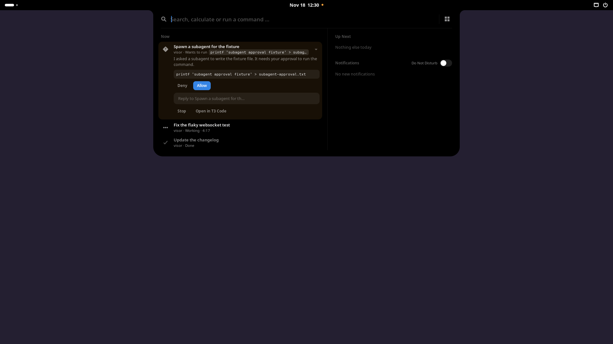

# Visor

A Dynamic Island and notch for GNOME Shell: media, timers, downloads, calendar, notifications, search and AI agent approvals in one panel below the top bar.



|                                        Peek                                        |                                   Search                                    |                             T3 Code                             |
| :--------------------------------------------------------------------------------: | :-------------------------------------------------------------------------: | :-------------------------------------------------------------: |
|  |  |  |

Visor replaces the date menu in the middle of the top bar with a notch. It rests as the clock, grows a little when something happens, and opens into a panel with what is going on right now, what is coming next, and a search field. Other GNOME extensions can add their own rows, sections and icons to it as modules.

While Visor is enabled, the date menu, with its calendar and notification list, is hidden. Disabling Visor brings it back unchanged.

## Features

- A notch below the top bar with four states: the clock at rest, a small hint, a row of chips that peek out, and the open panel.
- **Now**: what plays, what runs and what waits, such as players, timers, downloads and AI agent sessions.
- **Up Next**: the next calendar events and the notifications of the shell.
- One search field for commands, calculations, currency conversion, apps and the search providers of GNOME.
- The colours follow the top bar and the accent colour of the system, light or dark. Animations are off when the animations of GNOME are off.
- The shortcut of the shell for the notification list (Super+V by default) opens it, and one more shortcut can be set.
- Everything is optional: each built-in module can be turned off in the settings.
- Modules from other extensions plug in through a stable API.

## Built-in modules

<!-- modules:start (generated by scripts/readme-modules.mjs; do not edit) -->

| Module        | Slot    | What it shows                                                                                              |
| ------------- | ------- | ---------------------------------------------------------------------------------------------------------- |
| Media         | Now     | Players that report through MPRIS: cover, title, artist, the controls and a progress line.                 |
| Timers        | Now     | Timers, alarms and stopwatches started from the search, with a notification when one ends.                 |
| Downloads     | Now     | Running downloads, found through the partial files browsers write, then Open and Show in folder.           |
| T3 Code       | Now     | Agent sessions of the T3 Code server, with approvals you can answer in the row.                            |
| Up Next       | Up Next | The next events of the calendars GNOME knows, with a Join button for video calls shortly before the start. |
| Notifications | Up Next | The notifications of the shell, newest first, with Do Not Disturb and Clear all.                           |

<!-- modules:end -->

## Requirements

- GNOME Shell 50 or 51 (`shell-version` in `metadata.json`). Other versions are not supported.
- The Join button of Up Next needs the typelibs of Evolution Data Server (`ECal`, `EDataServer`). Without them the button is missing and nothing else changes.
- The T3 Code module needs a running [T3 Code](https://github.com/pingdotgg/t3code) server. Without one it stays empty.

## Install

From extensions.gnome.org: _link after release._

From the AUR (Arch and derivatives): `gnome-shell-extension-visor`, _after release_. The recipe is in [build-aux/aur](build-aux/aur/README.md).

From source. You need Node 24 or newer, pnpm, `glib-compile-schemas` (libglib2.0-bin or glib2), gettext and zip.

```sh
pnpm install && pnpm build && pnpm pack:zip
gnome-extensions install --force dist/visor@taulit.github.io.shell-extension.zip
```

Log out and in again (on Wayland the shell cannot be restarted), then enable it:

```sh
gnome-extensions enable visor@taulit.github.io
```

The settings are in the Extensions app or with `gnome-extensions prefs visor@taulit.github.io`.

## Search

Type in the field of the open panel. Arrow keys choose, Enter runs, Ctrl+Enter runs the alternative action of a result, Escape clears the field and then closes the panel.

| You type                                             | What happens                                                                          |
| ---------------------------------------------------- | ------------------------------------------------------------------------------------- |
| `timer 25m Pizza`, `timer 1h30 Laundry`, `timer 90s` | Starts a countdown with an optional name.                                             |
| `timer 18:30 Meeting`, `timer 6:30 pm`               | Starts an alarm for the next time the clock shows that time.                          |
| `stopwatch Research` (also `stoppuhr`)               | Starts a stopwatch.                                                                   |
| `t3 Please add a test`                               | Sends the text to the thread of T3 Code that was active last, or starts a new thread. |
| `1+1`, `sqrt(16)`, `2 ^ 3`, `20% of 80`, `pi*2`      | Calculates. Enter copies the result.                                                  |
| `100 usd in eur`, `50 chf`, `100$ €`                 | Converts with the daily rates of the European Central Bank. Enter copies the result.  |
| `fire`                                               | Apps that match, then the results of module and GNOME search providers.               |

The calculator is a small parser of its own, not `eval`. It knows `+ - × ÷ * / ^ %`, brackets, `sqrt sin cos tan log ln abs round`, `pi` and `e`, and reads numbers in the notation of your locale. Timer words are understood in English and German.

## Privacy and network

Visor has no account, no telemetry and no server of its own. These are all the requests it can make:

| Request                                                                                                       | When                                                                                                                                                                                                                                                                   | Turn it off                                                                                                                                                                            |
| ------------------------------------------------------------------------------------------------------------- | ---------------------------------------------------------------------------------------------------------------------------------------------------------------------------------------------------------------------------------------------------------------------- | -------------------------------------------------------------------------------------------------------------------------------------------------------------------------------------- |
| `https://www.ecb.europa.eu/stats/eurofxref/eurofxref-daily.xml`, the daily rates of the European Central Bank | Only when you type a currency conversion, and at most once a day. The answer is kept in `~/.cache/visor/rates.json`.                                                                                                                                                   | The switch "Load currency rates" in the settings (General, Search), or `gsettings set org.gnome.shell.extensions.visor currency-rates false`. The search then says that rates are off. |
| The cover picture a player names in `mpris:artUrl`, when it is an `http` or `https` address                   | When a player reports one. Pictures are limited to 8 MB and kept in `~/.cache/visor`. `file://` covers are read from disk, not downloaded.                                                                                                                             | Turn off the Media module in the settings, or `gsettings set org.gnome.shell.extensions.visor disabled-modules "['media']"`.                                                           |
| The T3 Code server: HTTP and a WebSocket                                                                      | Only after you paired Visor in the settings (an access token is stored). Without a `t3-server-url` Visor reads the address of the server on this machine from `server-runtime.json` below `~/.t3` (or `$T3CODE_HOME`). Plain `http` is accepted for this machine only. | Turn off the T3 Code module, or press Disconnect in the settings. With no token Visor makes no request. See [docs/t3-protocol.md](docs/t3-protocol.md).                                |
| The same server, from the settings window                                                                     | Only when you press Connect: a request for the server descriptor and the exchange of the pairing code for a token.                                                                                                                                                     | Do not pair.                                                                                                                                                                           |

What else Visor stores: the timers (setting `timers`), the module order and the list of turned-off modules, all in GSettings. The T3 Code access token is kept in the system keyring (libsecret), not in GSettings.

Disconnect only forgets the token on this machine; the protocol lets a session not revoke itself, so revoke it in T3 Code if you want it invalid. The Discover group of the settings shows a link to the website and fetches nothing. A catalogue of modules is planned, not part of this version.

## Write a module

A module is a GNOME extension of its own that calls `connectVisor()` and hands Visor rows, a section or a dock view. Visor never loads code from the network; modules are installed like any other extension.

- The contract: [docs/api-v1.md](docs/api-v1.md). It is frozen as version 1.
- Types and the `connectVisor()` helper: [sdk/](sdk/README.md), published as `@taulit/visor-module` (after release).
- Start from the template: [taulit/visor-module-template](https://github.com/taulit/visor-module-template) ("Use this template", public after release). The same files are in [examples/module-template](examples/module-template/README.md).
- Ideas that are not built yet: [docs/module-ideas.md](docs/module-ideas.md).

## Development

```sh
pnpm install
```

| Script                | Purpose                                                               |
| --------------------- | --------------------------------------------------------------------- |
| `pnpm build`          | Compile TypeScript and assemble an installable `build/` directory     |
| `pnpm pack:zip`       | Build and create `dist/visor@taulit.github.io.shell-extension.zip`    |
| `pnpm typecheck`      | Type-check with `tsc --noEmit`                                        |
| `pnpm lint`           | ESLint and `prettier --check`                                         |
| `pnpm format`         | Format with Prettier                                                  |
| `pnpm test`           | Unit tests of the pure logic (Vitest)                                 |
| `pnpm test:shell`     | Tests that run in a sandboxed headless GNOME Shell, and the leak test |
| `pnpm readme`         | Rewrite the module table of this file                                 |
| `pnpm readme:check`   | Fail when the module table is stale                                   |
| `pnpm sdk:check`      | Fail when `sdk/` does not match `src/api.ts`                          |
| `pnpm template:check` | Build the module template in a clean copy                             |
| `pnpm pot`            | Regenerate `po/visor.pot` and merge it into `po/*.po`                 |

The shell tests need GNOME Shell 50 and `dbus-run-session`. They run in a sandbox with their own home directory, D-Bus session and settings (`scripts/nested.sh`) and never touch the shell you are logged in to. `scripts/shots.sh` takes the screenshots in [docs/screenshots](docs/screenshots) in the same sandbox, and `scripts/shell-shot.sh <scenario>` takes one.

How the code is organised: [docs/architecture.md](docs/architecture.md). Which shell APIs were checked and how: [docs/verified.md](docs/verified.md). Status and open items: [docs/STATUS.md](docs/STATUS.md), [docs/handoff.md](docs/handoff.md). Releasing: [docs/release-checklist.md](docs/release-checklist.md). Review against the extensions.gnome.org rules: [docs/ego-checklist.md](docs/ego-checklist.md).

## Translations

The source language is English. German is the reference translation. Spanish, French, Brazilian Portuguese, Italian, Polish, Russian, Simplified Chinese and Japanese are machine translated, and corrections are welcome. To fix a text or add a language, see [docs/translating.md](docs/translating.md).

## License

GPL-2.0-or-later, see [LICENSE](LICENSE). The package in [sdk/](sdk/) and the module template are MIT, so a module can use any license.
